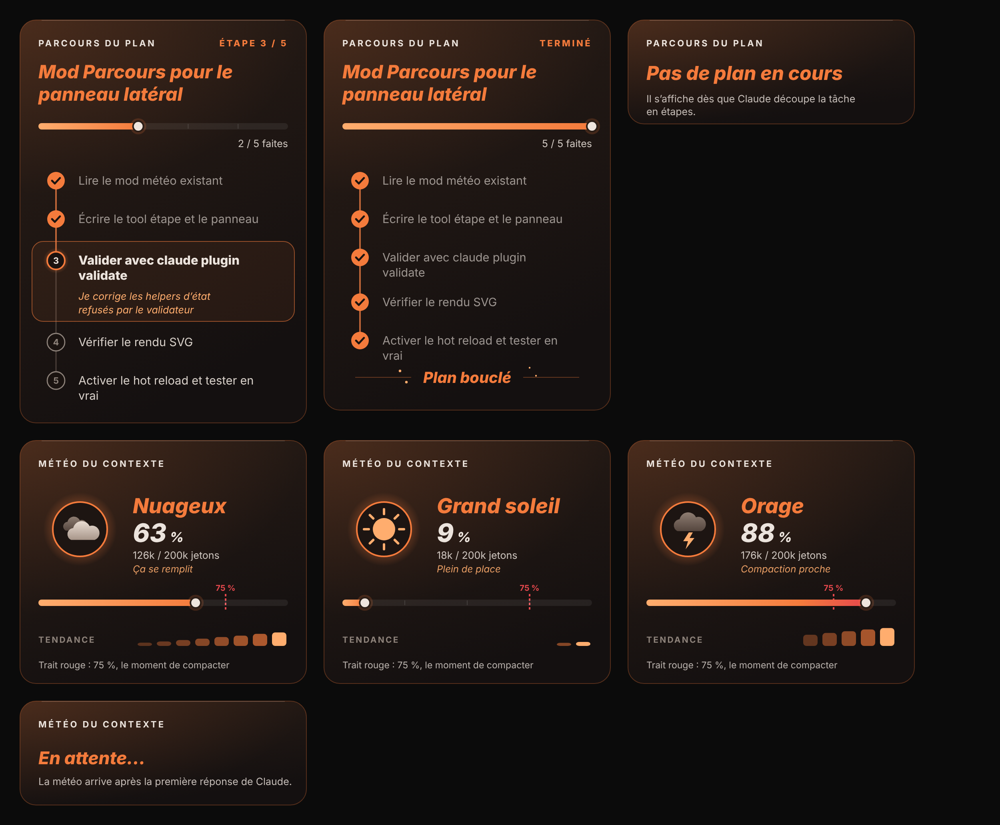

# MyMods

Mes mods pour Claude Code.

## boussole-du-plan



Un panneau latéral « Plan & météo » qui montre :

- **Où on en est dans le plan** : l'étape en cours (« Étape 2 sur 3 »), une barre de progression et la liste des étapes (✓ terminée, ▶ en cours, ○ à venir), mise à jour à chaque fois que Claude crée ou coche une étape.
- **La météo du contexte** : le remplissage de la fenêtre de contexte, de ☀️ Grand soleil à 🌪️ Tempête, avec une jauge et les tokens utilisés.

Sur l'app desktop, VS Code et l'app mobile, le panneau est dessiné en deux cartes (SVG) :

- **Parcours du plan** : le nom de la tâche, « Étape 3 / 5 », une barre de progression, les étapes sur un chemin qui s'allume au fil du plan, l'étape en cours mise en avant avec ce que Claude y fait, et « Plan bouclé » à la fin.
- **Météo du contexte** : le ciel dessiné (soleil, nuages, pluie, orage, tornade), le pourcentage, les jetons, une jauge avec le trait rouge à 75 % (le moment de compacter) et la tendance des dernières mesures.

Dans le terminal, le panneau reste en texte.

La commande `/plan-meteo` rouvre le panneau. Là où l'app n'affiche pas de panneau (l'app mobile), `/plan-meteo` dessine les deux cartes directement dans la conversation, et elles se mettent à jour d'elles-mêmes.

Une ligne courte à côté de la zone de saisie (par exemple `☀️ 9% · Grand soleil`) donne aussi la météo du contexte et se met à jour après chaque réponse de Claude.

Quand rien ne peut dessiner les cartes, `/plan-meteo` répond avec le plan et la météo sous forme de texte.

### Installation

À l'invite d'une session Claude Code dans un terminal :

```
/plugin install boussole-du-plan --marketplace felipemaciasito-cmyk/MyMods
```

Répondre `y` pour ajouter la marketplace, puis choisir une portée.

Depuis un shell :

```
claude plugin install boussole-du-plan --marketplace felipemaciasito-cmyk/MyMods
```

Dans l'app desktop : cliquer sur + à côté de la zone de saisie, puis Plugins, Add marketplace avec `felipemaciasito-cmyk/MyMods`, puis Add plugin.
